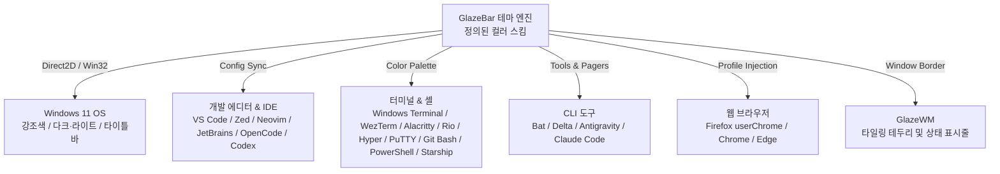

<div align="center">

# GlazeBar + GlazeWM

Next-Generation High-Performance Tiling Window Management & System Status Suite for Windows 11

[](https://github.com/partrita/GlazeBar/releases)
[](LICENSE)
[-0078d4.svg?style=flat-square&logo=windows)](https://github.com/partrita/GlazeBar)
[](native-rust)
[](.github/workflows/test.yml)

[한국어](README.md) · [English](README.en.md)

</div>


## 📌 개요 (Overview)

GlazeBar는 Windows 11 환경을 위한 초경량·고성능 Rust 기반 네이티브 상태 표시줄(Top Bar)과 안정화 패치가 적용된 타이밍 윈도우 매니저(GlazeWM 3.10.1-glazebar.2)를 결합한 올인원 데스크톱 환경 솔루션입니다.

> 💡 원작자 크레딧 (Original Author & Upstream):  
> 본 프로젝트는 [lamininA1/GlazeBar](https://github.com/lamininA1/GlazeBar)의 원작을 기반으로 포크 및 발전시킨 프로젝트입니다. 훌륭한 초기 아키텍처와 아이디어를 제공해 주신 원작자 [lamininA1](https://github.com/lamininA1)님께 깊은 감사를 표합니다.

기존 웹 기술(WebView2/Chromium) 기반 상태 표시줄의 높은 자원 점유율(수백 MB 메모리 소모)을 극복하기 위해, 전체 런타임을 순수 Rust와 Win32 Direct2D 네이티브 엔진으로 재설계했습니다. 최소한의 리소스만으로 반응 속도가 뛰어난 윈도우 관리 및 전체 데스크톱 생태계 테마 동기화 환경을 제공합니다.


## ⚡ 벤치마크 및 리소스 성능 (Performance)

동일 하드웨어 환경(Surface Pro 11 / Snapdragon X Plus X1P-64-100 / Windows 11 ARM64)에서 기존 웹 기반 상태 표시줄 솔루션과 실측 비교한 결과입니다.

| 지표 | 기존 WebView2 기반 (Zebar) | GlazeBar (Native Rust) | 개선율 |
| :--- | :--- | :--- | :--- |
| 작업 집합 메모리 (Working Set) | 799.7 MiB | 25.18 MiB | 96.8% 절감 |
| 전용 메모리 (Private Bytes) | 331.4 MiB | 5.05 MiB | 98.4% 절감 |
| 상주 프로세스 수 (Processes) | 13개 프로세스 | 단일(1개) 프로세스 | 단순화 |
| CPU 상시 점유율 (Idle) | 0.058% | 0.047% | 초저전력 최적화 |

> 📊 상세한 벤치마크 조건과 측정 프로파일링 로그는 [docs/performance.md](docs/performance.md)에서 확인하실 수 있습니다.


## 🚀 다운로드 및 설치 (Download & Installation)

GlazeBar는 x64 및 ARM64(Copilot+ PC, Snapdragon X) 아키텍처를 네이티브로 지원하며, 독립적인 Inno Setup 통합 설치 프로그램을 제공합니다.

| 플랫폼 아키텍처 | 통합 설치 패키지 (All-in-One Installer) |
| :--- | :--- |
| Windows 11 (x86_64 / Intel / AMD) | [⬇️ GlazeBar-GlazeWM-Setup-x64.exe](https://github.com/partrita/GlazeBar/releases/latest) |
| Windows 11 on ARM (ARM64 / Snapdragon) | [⬇️ GlazeBar-GlazeWM-Setup-arm64.exe](https://github.com/partrita/GlazeBar/releases/latest) |

### 설치 가이드
1. 사용하는 PC 아키텍처에 맞는 최신 설치 프로그램(`.exe`)을 다운로드합니다.
2. 기존에 실행 중인 `GlazeWM` 또는 `GlazeBar`가 있다면 종료합니다.
3. 설치 프로그램을 실행하여 지침에 따라 설치를 완료합니다 (시작 시 자동 실행 옵션 제공).
4. 시작 메뉴에서 GlazeBar + GlazeWM을 실행하면 즉시 적용됩니다.

> 별도의 `.NET`, `Go`, `WebView2` 런타임 설치가 필요하지 않습니다. 기존 설정 파일은 자동으로 안전하게 백업됩니다.


## 🎯 핵심 기능 (Key Features)

### 1. 강력한 타일링 윈도우 관리 (Tiling Window Manager)
- 최적화된 GlazeWM 3.10.1 탑재: 창 이동 시 포커스 및 모니터 정보 유실 문제를 원천 차단한 커뮤니티 안정화 패치 빌드.
- Alt + M 고속 최소화 및 완벽 복원: 분할 구조, 화면 비율, 포커스 순서를 보존한 채 즉각 최소화 및 복원.
- 스마트 분할 트리 정리: 창 종료 또는 분할 변경 시 남는 빈 컨테이너를 다시 그리기(Redraw) 직전에 정리하여 데스크톱 영역 회수.

### 2. 고성능 네이티브 시스템 위젯 & 빠른 컨트롤
- 하드웨어 텔레메트리: 실시간 CPU 사용률, 물리 메모리 점유율, 배터리 잔량 및 충/방전 전력(W) 모니터링.
- 디스플레이 & 네트워크 즉시 제어: 표시줄 내 다이렉트 슬라이더를 통한 화면 밝기 조절, 디스플레이 배율(Scale), 주변 Wi-Fi 탐색 및 연결 메뉴.
- 전원 모드 전환: 고성능, 균형, 절전 구성표를 표시줄 팝업에서 원클릭으로 변경.

### 3. 지능형 테마 동기화 엔진 (Dynamic Theme Ecosystem)
- 정의된 컬러 스킴 선택: Catppuccin, Everforest, Rosé Pine, Monokai, Dracula, Tokyo Night 등 검증된 컬러 스킴을 다크·라이트 모드로 즉시 적용.
- Wallhaven 연동 탐색기: 데스크톱 내에서 고해상도 배경화면 검색, 필터링, 다운로드 및 캐싱 지원.


## 🎨 테마 연동 지원 매트릭스 (Theme Ecosystem Matrix)

GlazeBar에서 테마를 변경하면 시스템에 설치된 주요 개발 도구, 브라우저, 터미널 및 Windows 환경에 실시간으로 일관된 색상이 반영됩니다 (미설치 프로그램은 안전하게 자동 스킵).



| 범주 | 지원 대상 | 동기화 항목 |
| :--- | :--- | :--- |
| 운영체제 | Windows 11 | 시스템 다크/라이트 모드, 강조색(Accent Color), 작업 표시줄, 제목 표시줄 투명도 |
| 상단바 옵션 | GlazeBar Top Bar | 시간/날짜 표시 포맷(전체/시간만/날짜만/간략형/ISO), 상단바 투명도(100% ~ 0% 완전 투명) 조절 |
| 터미널 | Windows Terminal | 기본 프로필 배경/전경색, 커서, 16색 ANSI 색상 테이블 |
| | WezTerm / Alacritty / Rio | TOML/Lua 테마 파일 자동 생성 및 색상 블록 동기화 |
| | Hyper / PuTTY / Git Bash | JavaScript 설정, MinTTY `.minttyrc`, 레지스트리 세션 색상(`Colour0`~`Colour21`) 갱신 |
| 셸 & 프롬프트 | PowerShell / PSReadLine | `$PROFILE` 내 PSReadLine 24-bit TrueColor 구문 강조 자동 주입 |
| | Starship Prompt | `starship.toml` 내 커스텀 팔레트(`[palettes.glazebar]`) 및 활성 테마 설정 |
| 에디터 & IDE | VS Code | 편집기, 사이드바, 상태 표시줄, 통합 터미널 및 구문 강조(Syntax) 테마 |
| | Zed Editor / OpenCode | 전용 JSON 테마 생성 및 활성 테마 매핑 |
| | Neovim | `colors/glazebar-aether.lua` 하이라이트 생성 및 `init.lua` 테마 적용 |
| | JetBrains IDE 전 제품군 | IntelliJ, Rider, PyCharm, WebStorm 등 에디터 컬러 스킴(`.icls`) 및 XML 동기화 |
| CLI & Agent | Antigravity / Claude / Codex | CLI 설정 파일 내 색상 프로필 자동 반영 |
| 페이저 & 도구 | Bat / Delta | bat 문맥 강조 테마 및 Git delta diff 24-bit 신택스 테마 블록 |
| 브라우저 | Firefox / Chrome / Edge | `userChrome.css` 및 브라우저 프로필 테마 시드 색상 연동 |


## 🖥️ 모니터별 작업공간(Workspace) 고정 사용법

듀얼/트리플 모니터 환경에서 특정 작업공간을 원하는 모니터에 영구적으로 고정할 수 있습니다. `config.yaml`의 `workspaces:` 항목에 `bind_to_monitor`와 `keep_alive`를 설정합니다:

```yaml
workspaces:
  # 주 모니터 (0번)에 고정
  - name: '1'
    bind_to_monitor: 0
    keep_alive: true
  - name: '2'
    bind_to_monitor: 0
    keep_alive: true

  # 보조 모니터 (1번)에 고정
  - name: '3'
    bind_to_monitor: 1
    keep_alive: true
  - name: '4'
    bind_to_monitor: 1
    keep_alive: true

  # 필요 시 자유롭게 이동하며 사용할 작업공간
  - name: '5'
```

- **`bind_to_monitor: 0`**: Windows 주 디스플레이 (메인 모니터)에 작업공간 고정
- **`bind_to_monitor: 1`**: 보조 디스플레이 (서브 모니터)에 작업공간 고정
- **`keep_alive: true`**: 해당 작업공간에 열려 있는 창이 없더라도 작업공간이 닫히지 않고 모니터에 항상 유지

> 💡 **특정 프로그램 자동 배치 (`window_rules`)**:  
> 예를 들어 카카오톡이나 디스코드를 항상 3번 작업공간(보조 모니터)으로 자동 실행하려면 `config.yaml`의 `window_rules:`에 다음 설정을 추가합니다:
> ```yaml
> window_rules:
>   - commands: ['move --workspace 3']
>     match:
>       - window_process: { equals: 'KakaoTalk' }
>       - window_process: { equals: 'Discord' }
> ```


## ⌨️ 기본 단축키 (Keyboard Shortcuts)

| 단축키 | 기능 설명 |
| :--- | :--- |
| `Win + F1` | 전체 단축키 및 Quick Start 안내 창 호출 |
| `Win + Alt + Shift + B` | 상태 표시줄(GlazeBar) 보이기 / 숨기기 토글 |
| `Win + Ctrl + Alt + Space` | 배경화면 및 테마 선택 관리자 열기 |
| `Alt + M` | 현재 작업공간 내 창 전체 최소화 및 원래 레이아웃 복원 |
| `Alt + Shift + E` | GlazeWM 안전 종료 |


## 🛠️ 소스 빌드 및 개발 (Development & Build)

### 요구 사양
- OS: Windows 11 (x64 / ARM64)
- Toolchain: Rust 1.80+ (MSVC 타깃: `x86_64-pc-windows-msvc` 또는 `aarch64-pc-windows-msvc`)
- 컴파일러: Visual Studio C++ Build Tools 및 Windows SDK

### 빌드 절차
```bash
# 1. 저장소 클론
git clone https://github.com/partrita/GlazeBar.git
cd GlazeBar/native-rust

# 2. 의존성 무결성 검증 및 단위 테스트
cargo test --locked

# 3. Release 바이너리 빌드
cargo build --locked --release --target x86_64-pc-windows-msvc
```

> 전체 인스톨러 패키징 및 GlazeWM 소스 패치에 관한 내용은 [distribution/BUILDING.md](distribution/BUILDING.md)를 참조하세요.


## 📜 라이선스 및 크레딧 (License & Acknowledgments)

- GlazeBar: [GNU General Public License v3.0 (GPL-3.0-only)](LICENSE)
- 원작자 (Original Project): [lamininA1/GlazeBar](https://github.com/lamininA1/GlazeBar) by [lamininA1](https://github.com/lamininA1)
- 포함 및 참조 프로젝트:
  - [GlazeWM](https://github.com/glzr-io/glazewm) (GPL-3.0) — 윈도우 타일링 관리 엔진
  - [Aether](https://github.com/omacom/aether) — 지능형 팔레트 양자화 및 색상 추출 알고리즘
  - [Lucide Icons](https://github.com/lucide-icons/lucide) (ISC) — 고품질 UI 벡터 아이콘
  - [Pretendard](https://github.com/orioncactus/pretendard) (SIL OFL 1.1) — 가독성 높은 시스템 기본 글꼴

자세한 오픈소스 고지 사항은 [THIRD-PARTY-NOTICES.txt](THIRD-PARTY-NOTICES.txt)에 명시되어 있습니다.
